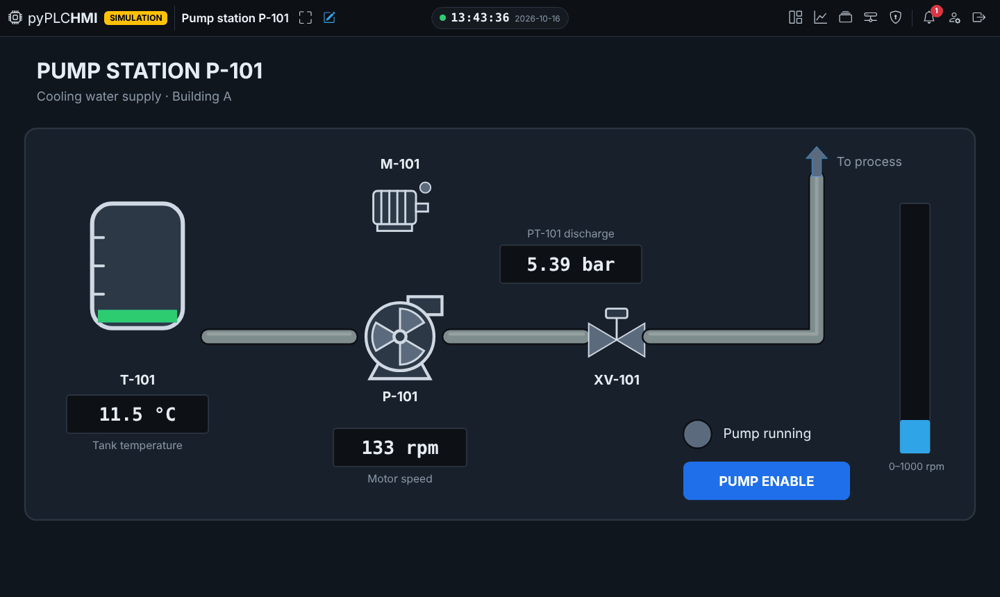
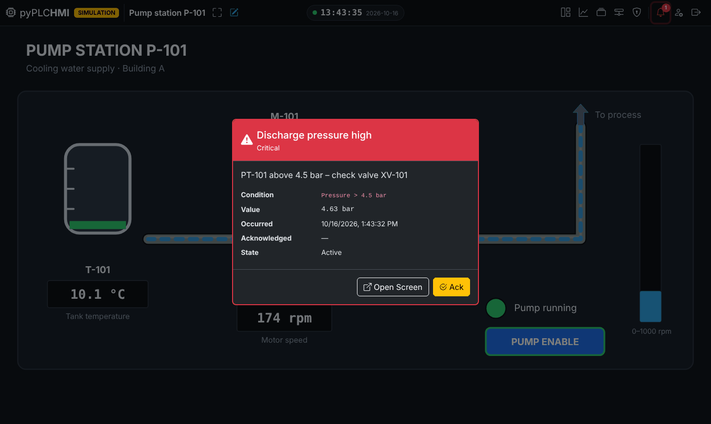
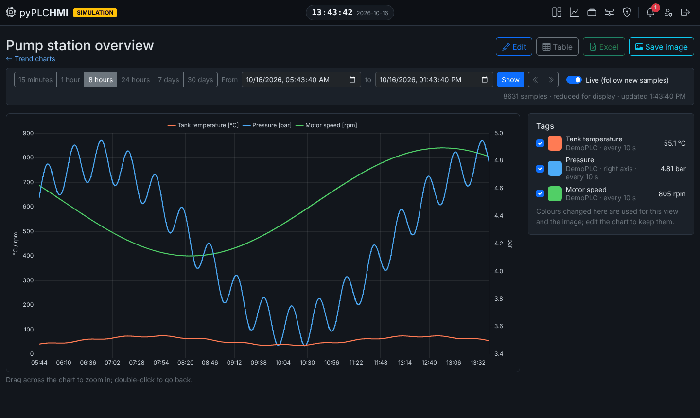
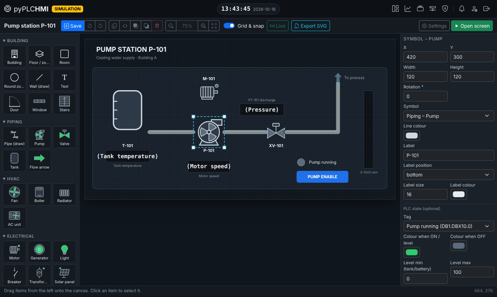
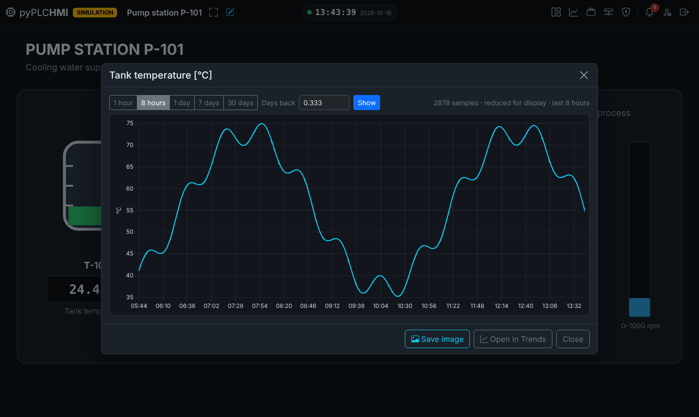

# pyPLCHMI

[](https://github.com/meshesha/pyPLCHMI/actions/workflows/tests.yml)
[](LICENSE)


**A web-based HMI / light SCADA for Siemens S7, Modbus and BACnet – built in Python, running in any browser.**

Draw a P&ID-style screen, bind it to PLC tags, and open it on any PC, tablet or wall display on
the plant network. No runtime licenses, no client installation, no tag limits.



---

## Why pyPLCHMI?

Classic HMI packages are great on the panel and painful everywhere else. With pyPLCHMI, the
operator station is just a browser window, and the engineering tools are on the same server.

| | |
|---|---|
| 🔌 **Talks to your field devices** | Siemens **S7-300/400/1200/1500 & LOGO!** (snap7), **Modbus TCP / RTU** (PyModbus, pyModbusTCP), **BACnet/IP** (BAC0, Who-Is & object browser) |
| 🖌️ **Graphic screens** | Drag-and-drop SVG designer: pumps, valves, tanks, motors, pipes with animated flow, live values, lamps, bars, buttons, ~5,200 icons, your own images & animated GIFs |
| 🚨 **Alarms** | Tag conditions (`>`, `≥`, `=`, `≠`…) with Critical/High/Low severity, pop-up with *Ack* / *Open Screen*, event history, PLC communication-loss alarms |
| 📈 **Historian & trends** | Per-tag sampling interval, multi-pen trend charts, zoom, live mode, Excel export, save charts as PNG |
| 🖱️ **Right-click any value** | *Show graph* (last *N* days) and *Details*: PLC, address, data type, scaling, alarms, attached manuals |
| 📚 **Information library** | Attach manuals, wiring diagrams and photos (PDF / images) to each PLC; SHA-1 de-duplication |
| 🔐 **Security & audit** | Built-in Admin / Operator / Viewer / Guest roles plus your own, **per-tag write rights by role** (only the shift lead may change that set-point), bcrypt passwords, CSRF protection, full **audit log** (who changed what – before/after values) |
| 📡 **Knows when it's blind** | A Web Worker heartbeat raises a red *Connection to the server lost* banner within seconds, greys out stale values, and shows when the server is back or was restarted. It also works in background tabs and full screen. |
| 🌍 **Built for the floor** | Dark & light mode, full-screen kiosk mode, public wall-display screens, screen list as cards or a sortable/filterable table, English & Hebrew (RTL) + your own language files |
| 🧪 **Simulator included** | `PLC_SIMULATION=1` – develop and demo without hardware |

## Screenshots

| Alarm pop-up | Trend charts |
|---|---|
|  |  |
| **SVG screen designer** | **Right-click → Show graph** |
|  |  |

## Quick start

Requires **Python 3.10+** (Windows, Linux or macOS).

```bash
git clone https://github.com/meshesha/pyPLCHMI.git
cd pyPLCHMI
python -m venv venv
source venv/bin/activate          # Windows: venv\Scripts\activate
pip install -r requirements.txt

cp .env.example .env              # Windows: copy .env.example .env  – set SECRET_KEY
flask db upgrade                  # create the database
flask seed                        # roles & permissions
flask create-admin                # your first user
flask demo                        # optional: demo PLC + screen (works with the simulator)
flask run                         # → http://127.0.0.1:5000
```

`.env.example` starts with `PLC_SIMULATION=1`, so the demo runs without hardware. Set it to `0`,
add your PLC under **PLCs**, and build screens from your real tags.

## Addressing at a glance

| Protocol | Examples |
|---|---|
| Siemens S7 | `DB1.DBD4:REAL` · `DB1.DBX0.0` · `MW20` · `M10.5` · `IW64` · `Q0.1` · `DB2.DBB20:STRING[20]` |
| Modbus | `HR100` / `40101` · `IR5` · `C12` · `DI3` · `HR10.3` (bit) · `HR200:REAL` (byte/word order per device) |
| BACnet/IP | `AI1` · `AO2` · `AV3@10` (write priority) · `BV5` · `MV2` · `AI1.units` |
| Dummy PLC | internal tags without a device – general (shared) or local (per browser window) |

S7-1200/1500: enable *PUT/GET access* and disable *optimized block access* for the DBs you read.

## Deployment

**Docker** (x86-64 or ARM64, e.g. an industrial PC or a Raspberry Pi):

```bash
cp .env.example .env              # set SECRET_KEY, HMI_ADMIN_USER, HMI_ADMIN_PASSWORD, PLC_SIMULATION=0
docker compose up -d --build      # → http://<host>:8000
```

The data is kept in a volume. The database is migrated on every start, and there is a
health check. For BACnet broadcasts and Modbus RTU serial ports, see
**[docs/DOCKER.md](docs/DOCKER.md)**.

**Air-gapped plant network (Windows or Linux, no Docker):** download the source and the Python
wheels on a connected PC, carry them across, and install with `pip install --no-index`. The
**[offline installation guide](docs/OFFLINE_INSTALLATION.md)** covers it step by step: system
requirements, what to download, the venv set-up, a Windows scheduled task or a Linux systemd
service, and the firewall.

**Without Docker:**

```bash
FLASK_CONFIG=production SECRET_KEY=<random> flask db upgrade
waitress-serve --host 0.0.0.0 --port 8000 --threads 8 wsgi:app
```

Run **one process** (threads are fine) – every process opens its own PLC connections and runs its
own alarm scanner and historian. Put a reverse proxy with HTTPS in front and set
`SESSION_COOKIE_SECURE=1`.

> ⚠️ **OT security note** – this is a supervisory tool. Keep it on a segmented OT network (or behind
> a VPN / DMZ), never expose it directly to the internet, and only grant the *write values*
> permission to trained operators. Safety functions belong in the PLC / safety system, never in
> the HMI.

## Documentation

* **[User guide](docs/USER_GUIDE.md)** – configuration, every feature, roles, Excel import/export,
  languages, migrations, tests.
* **[Offline installation](docs/OFFLINE_INSTALLATION.md)** – Windows & Linux without Internet: requirements, downloads, step-by-step set-up, upgrades.
* **[Docker](docs/DOCKER.md)** – requirements checklist, volumes, OT networking, operation.
* **[Architecture](docs/ARCHITECTURE.md)** – how the pieces fit together, for contributors.

## Tech stack

Flask 3 (application factory, blueprints) · SQLAlchemy 2 + Flask-Migrate · Flask-Login / Bcrypt /
WTF · python-snap7 · PyModbus · pyModbusTCP · BAC0 · Bootstrap 5 · SweetAlert2 · Chart.js — all
front-end libraries are bundled, so the HMI works on networks **without internet access**.

## Development

```bash
pip install -r requirements-dev.txt
pytest                  # 652 tests, incl. a real snap7 S7 server on localhost
```

Contributions, bug reports and feature ideas are welcome – please
[open an issue](https://github.com/meshesha/pyPLCHMI/issues) first for larger changes.

## License

[MIT](LICENSE). Bundled third-party libraries keep their own licenses (see `app/static/vendor`).
